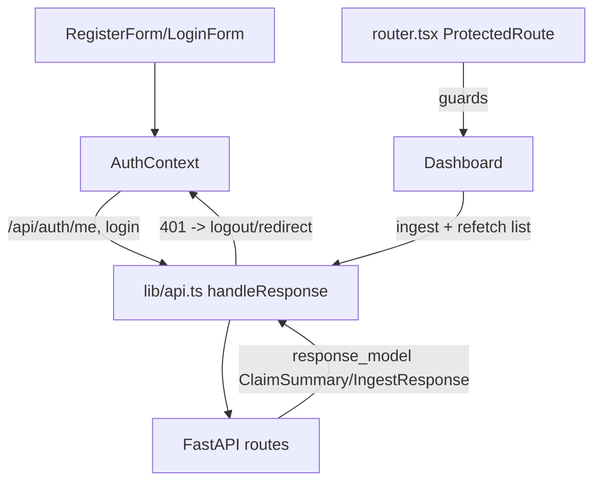

# Requirements

### Overview & Goals
Fix all 13 previously identified critical bugs so the dashboard works end-to-end without visible errors: authenticated claim ingestion, correct data shapes, protected routes, and robust auth/session handling. All fixes must integrate seamlessly with the existing (partially fixed) unstaged changes and must not break currently functioning code.

### Current State (from commits + unstaged changes)
The unstaged working-tree changes already fixed or partially fixed:
- **#3 (swallowed exceptions in routes)** — route handlers now use `logger.exception` with safe messages. `pipeline._extract` still needs verification.
- **Auth on ingest** — `/claims/ingest` now requires a JWT (`get_current_user`), returns typed `IngestResponse`, and has 401/429 handling.
- **#6 (verdict fallback)** — pipeline now forces `label/verdict = UNVERIFIED`.

Still broken and in scope:

 # | Bug | Location |
---|---|---|
 1 | `list_claims` returns raw Supabase rows (leaks `embedding` etc.) — no `response_model` | `backend/app/routes/claims.py` |
 2 | Register raises `HTTPException(202)` as an "error" — frontend mishandles it | `backend/app/routes/auth.py` |
 3b | `pipeline._extract` silently swallows exceptions | `backend/app/services/pipeline.py` |
 5 | Dead duplicate JWT config (`SECRET_KEY`/`ALGORITHM` unused) | `backend/app/config/config.py` |
 7 | Dashboard listed under public routes; `ProtectedRoute` never used | `frontend/src/routes/router.tsx` |
 8 | Theme DOM mutation runs during render, not in `useEffect` | `frontend/src/context/AppContext.tsx` |
 9 | Reducer `default` case throws (`'Unknown actionS'`) | `frontend/src/context/AppContext.tsx` |
 10 | `Claim` interface doesn't match backend `IngestResponse`; UI breaks after ingest | `frontend/src/lib/api.ts`, `Dashboard.tsx` |
 11 | `user` never populated — `/api/auth/me` never called | `frontend/src/context/AuthContext.tsx` |
 12 | No 401/token-expiry handling; requests silently fail after 30 min | `frontend/src/lib/api.ts`, `AuthContext.tsx` |
 13 | `confirmPassword` stripped but never validated | `frontend/src/context/AuthContext.tsx` / `RegisterForm` |
 4 | Module-level mutable Supabase client globals (thread safety) | `backend/app/core/supabase.py` |

### Scope
**In scope:** the 13 bugs above; aligning frontend types with the new backend response schemas; keeping the unstaged backend changes intact.
**Out of scope:** new features, refactors beyond the fixes, schema.sql redesign, dataset loaders, Docker/infra changes.

### Non-Functional Requirements
- No regression to working endpoints (`/tree`, `/velocity`, `/platforms`, login flow, seed loaders).
- Error responses must not leak internal details; frontend must show user-friendly messages.

# Technical Design

### Key Decisions
- **Build on the unstaged changes, don't revert them.** The working tree already contains the authenticated-ingestion redesign (`ingest_claim_atomic`, `IngestResponse`, `research_resources_for`). All fixes layer on top.
- **Client-side auth guard via existing `ProtectedRoute`** — it already exists in the codebase; just wire it into the router (no new auth machinery).
- **Centralized 401 handling in `api.ts`** — a small response-handling helper that clears the stored token and redirects to `/login` on 401, instead of per-call checks.

### Proposed Changes

#### Backend
1. **`routes/claims.py`** — add `response_model=list[ClaimSummary]` to `GET /claims`; ensure `pipeline.list_claims()` selects only `ClaimSummary` fields (no `embedding`).
2. **`routes/auth.py`** — replace `HTTPException(202)` on email-confirmation with a normal `200` JSON body like `{"status": "confirmation_required", "message": ...}`; keep the token response shape unchanged for the normal path. Frontend register flow checks for `access_token` presence before auto-login.
3. **`services/pipeline.py`** — in `_extract`, replace bare `except Exception: pass` with `logger.warning(...)`/`logger.exception(...)` and a documented fallback, so config errors (missing Gemini key) are visible in logs.
4. **`config/config.py`** — remove unused `SECRET_KEY`/`ALGORITHM` after grepping to confirm nothing references them; keep `SUPABASE_JWT_SECRET` as the single JWT source of truth. Update `.env.example` accordingly.
5. **`core/supabase.py`** — guard `_service_client`/`_anon_client` initialization with `threading.Lock` (or `functools.lru_cache`-based factories) for thread safety; keep public function signatures identical.

#### Frontend
6. **`routes/router.tsx`** — move `dashboard` under protected routes wrapped in the existing `ProtectedRoute`; unauthenticated visitors are redirected to `/login`.
7. **`context/AppContext.tsx`** — move `root.classList.remove/add` theme mutation into a `useEffect(..., [theme])`; change reducer `default` case to `return state` (remove the throwing `'Unknown actionS'`).
8. **`lib/api.ts`** — 
   - Update `Claim`/response interfaces to match backend: add `IngestResponse` type (`variant_id`, `parent_id`, `matched`, `similarity`, `canonical`, `domain`, `language`, `label`, `verdict`, `rationale`, `research_resources`, `variant_count`); align `ClaimSummary` type with `GET /claims`.
   - Add a shared `handleResponse` helper: on 401 → clear token + redirect to login; on other errors → throw with `detail` message.
9. **`pages/Dashboard.tsx`** — after `ingestClaim`, re-fetch the claims list and select the returned `id` (instead of assuming the ingest payload matches the list shape); surface 429/401 errors as friendly toasts/messages.
10. **`context/AuthContext.tsx`** — 
    - On login and on app mount with a stored token, call `GET /api/auth/me` and populate `user`; on failure, clear the session.
    - Register flow: validate `password === confirmPassword` before calling the API; after register, only auto-login if the response contains `access_token`, otherwise show the "check your email" confirmation message.

### Architecture Diagram

### Risks
- The unstaged pipeline changes are untested; fixes must be validated together with them (run backend, hit endpoints).
- `SECRET_KEY` removal: verify with grep that no module imports it before deleting.
- Redirect-on-401 inside `api.ts` must not fire on the login endpoint itself (avoid redirect loops).

# Testing

### Validation Approach
Run the backend (`uvicorn`) and frontend (`vite dev`) locally; exercise the API with scripted HTTP calls and verify frontend builds type-check (`tsc`/`vite build`).

### Key Scenarios
- `GET /claims` returns only `ClaimSummary` fields — no `embedding` key in the payload.
- Register with unconfirmed email → HTTP 200 with `confirmation_required`; frontend shows message, no crash.
- Register with mismatched passwords → blocked client-side with a clear error.
- Unauthenticated visit to `/dashboard` → redirected to `/login`.
- Authenticated ingest → claim appears in the list and gets selected; tree/velocity/platforms panels load.
- Expired/invalid token on any API call → token cleared, redirected to login (no silent failure).
- Theme toggle works and only mutates DOM in effect (no render warnings in React strict mode).

### Edge Cases
- Ingest with blank/oversized text → 422 handled gracefully in UI.
- Rate-limit (429) response → friendly message, not a crash.
- Unknown reducer action dispatched → state unchanged, no throw.
- `GEMINI_API_KEY` missing → `_extract` logs a warning and falls back; ingest still returns a valid response or clear 500.

### Test Changes
- No existing test suite was found; validation is via manual/scripted endpoint checks and `tsc --noEmit` / `vite build` for the frontend. Adding a formal test suite is out of scope.

# Delivery Steps

### ✓ Step 1: Fix backend API contract bugs (#1, #2, #3b)
Backend returns clean, typed responses and no longer misuses 202 or swallows extraction errors.

- Add `response_model=list[ClaimSummary]` to `GET /claims` in `backend/app/routes/claims.py` and ensure `pipeline.list_claims()` selects only summary fields (no `embedding`).
- In `backend/app/routes/auth.py`, replace `HTTPException(status_code=202)` with a `200` response body `{"status": "confirmation_required", ...}` for the email-confirmation path.
- In `backend/app/services/pipeline.py`, replace the silent `except Exception: pass` in `_extract` with logged warnings and a documented fallback.
- Smoke-test endpoints with the running backend to confirm no regressions to tree/velocity/platform routes.

### ✓ Step 2: Clean up backend config and client thread safety (#4, #5)
Backend has a single JWT config source and thread-safe Supabase client initialization.

- Grep for `SECRET_KEY`/`ALGORITHM` usages; remove the unused pair from `backend/app/config/config.py` and `backend/.env.example`, keeping `SUPABASE_JWT_SECRET` as the only JWT secret.
- Guard `_service_client`/`_anon_client` creation in `backend/app/core/supabase.py` with a `threading.Lock` (or cached factory), preserving existing function signatures used by loaders and routes.
- Verify the unstaged `create_user_client` / `ingest_claim_atomic` code paths still work unchanged.

### ✓ Step 3: Protect dashboard route and fix AppContext bugs (#7, #8, #9)
The dashboard requires login, and AppContext follows React rules without crash paths.

- Wire the existing `ProtectedRoute` component into `frontend/src/routes/router.tsx` and move the dashboard out of `routes.public`; unauthenticated users are redirected to `/login`.
- In `frontend/src/context/AppContext.tsx`, move the theme `classList` mutation into `useEffect(..., [theme])`.
- Change the reducer `default` case from `throw new Error('Unknown actionS')` to `return state`.
- Verify with `vite build` / dev run that navigation and theme toggling work.

### ✓ Step 4: Align frontend API types and add 401 handling (#10, #12)
Frontend types match the backend schemas and expired tokens trigger re-login instead of silent failure.

- In `frontend/src/lib/api.ts`, add an `IngestResponse` interface matching the backend (`variant_id`, `matched`, `similarity`, `canonical`, `research_resources`, `variant_count`, etc.) and align `Claim`/summary types with `GET /claims`.
- Add a shared `handleResponse` helper: on 401 (except the login call) clear the stored token and redirect to `/login`; otherwise throw the backend `detail` message.
- In `frontend/src/pages/Dashboard.tsx`, after `ingestClaim` re-fetch the claims list and select the returned `id`; show friendly messages for 401/429/422 errors.
- Run `tsc --noEmit` to confirm type alignment.

### ✓ Step 5: Fix auth flows: user profile, register confirmation, password check (#2-frontend, #11, #13)
AuthContext populates the user profile, handles email-confirmation registration, and validates passwords client-side.

- In `frontend/src/context/AuthContext.tsx`, fetch `GET /api/auth/me` after login and on mount when a token exists; store the profile in `user` and clear the session on failure.
- Validate `password === confirmPassword` before calling the register API; surface a clear error otherwise.
- After register, only auto-login when the response contains `access_token`; if `status === 'confirmation_required'`, show a "check your email" message instead.
- End-to-end verify: register → login → dashboard loads with user info → ingest a claim → tree/velocity/platform panels render.