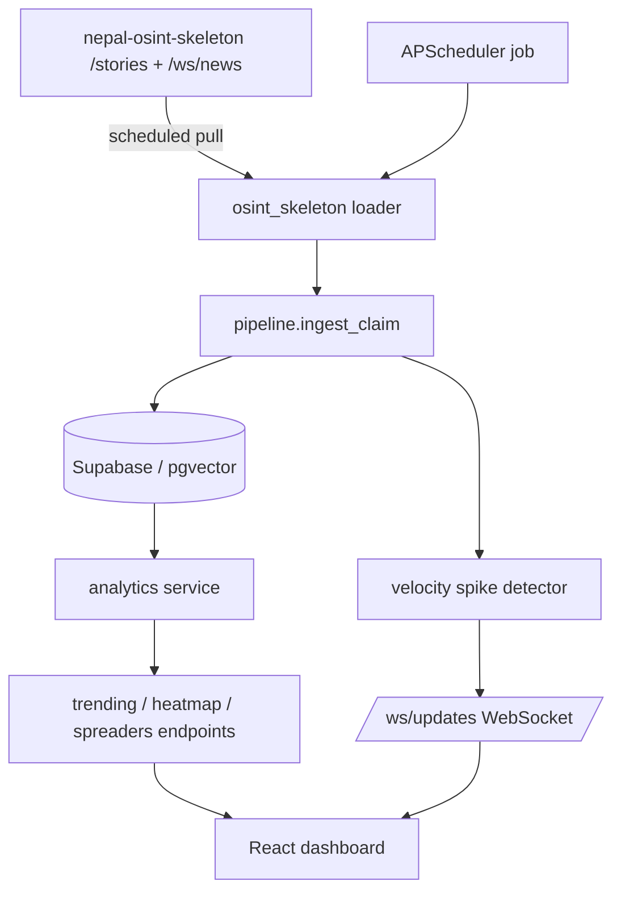

# Recommendations

### Overview

A prioritized, feasibility-ranked set of recommendations to evolve the **Misinformation Velocity Tracker** (FastAPI + Supabase/pgvector backend) from a seeded/manual claim tracker into a live, real-time OSINT platform, borrowing patterns from `nepal-osint-skeleton`. The final deliverable is a committed markdown file `docs/IMPROVEMENT_PLAN.md` capturing this list.

### Current State (grounded in the repo)

- **Backend only**: `backend/app` (FastAPI). No frontend folder exists yet.
- **Routes**: `routes/claims.py` exposes `POST /api/claims/ingest`, `GET /api/claims`, `/{id}/tree`, `/{id}/velocity`, `/{id}/platforms`; plus `auth.py`, `health.py`.
- **Services**: `pipeline.py` (ingest → embed → similarity → tree), `embeddings.py` (Gemini, 768-dim), `source_router.py` (domain → trusted sources), `tree.py`, `variant_generator.py`.
- **Data**: Supabase Postgres with `claims` + `variants` tables, `pgvector` + `match_variants` RPC (`schema.sql`). Static loaders in `app/data/loaders` (chhatramani, misdetect, nepoc).
- **Gaps**: no live ingestion, no scheduler, no WebSocket, no Redis, no aggregate dashboard endpoints (heatmap / leaderboard / trending), no frontend.

### Feasibility-Ranked Recommendations

Each item is scored **Feasibility** (effort/risk, higher = easier) and **Impact** (demo/hackathon value).

 # | Recommendation | Feasibility | Impact | Notes |
---|----------------|-------------|--------|-------|
 1 | **Trending / Hot Topics endpoint** `GET /api/claims/trending` | ★★★★★ | High | Pure SQL aggregate over existing `variants.ts` + `claims`; no new infra. Powers a "currently viral" panel. |
 2 | **Heatmap data endpoint** `GET /api/claims/heatmap` | ★★★★★ | High | Aggregate variant counts by time-bucket × platform (or domain). Reuses `variants` only. |
 3 | **Rumor-Spreader Ledger** (`GET /api/spreaders`, "FBI most-wanted" list) | ★★★★☆ | High | Aggregate by `variants.author` + repeat-offender scoring on `label=FAKE`. Add a small `spreaders` view/table. |
 4 | **APScheduler background worker** for periodic variant discovery | ★★★★☆ | Medium | Adopt skeleton's scheduler pattern; every N min re-embed & re-cluster pending items. In-process, no extra service. |
 5 | **Live news ingestion adapter** (pull `nepal-osint-skeleton /api/v1/stories`) | ★★★☆☆ | High | New loader that pipes stories → existing `pipeline.ingest_claim`. Needs mapping of source→platform + de-dup. |
 6 | **WebSocket real-time feed** `/ws/updates` + velocity-spike detector | ★★★☆☆ | High | Broadcast new variants / spike alerts to dashboard. Fits FastAPI natively; spike rule = N sources in M minutes. |
 7 | **Redis pub/sub layer** for multi-worker broadcasting | ★★☆☆☆ | Medium | Only needed once worker + API are separate processes; lift skeleton's `docker-compose` wiring. |
 8 | **React dashboard** (heatmap, ledger, trending, mutation tree, velocity) | ★★☆☆☆ | High | Largest effort (no frontend exists). Consumes endpoints #1–#6. |

### Scope

**In scope (this plan):** author `docs/IMPROVEMENT_PLAN.md`; specify the aggregate endpoints (#1–#3); specify the scheduler + live-ingestion + WebSocket design (#4–#6); note infra/frontend (#7–#8) as follow-ups.

**Out of scope:** actually building the React frontend, production Redis/K8s deployment, ML re-training. These are documented as future phases, not implemented here.

# Technical Design

### Guiding Principle

Deliver the **highest feasibility-per-impact** items first — read-only aggregate endpoints that need zero new infrastructure — then layer automation (scheduler, live ingestion), then real-time (WebSocket/Redis), then UI. This keeps each phase demoable.

### Current Implementation (reference points)

- `pipeline.ingest_claim(text)` — the single funnel every new claim/variant should go through (embed via `embeddings.py` → `match_variants` RPC → attach to tree). Live ingestion and the scheduler must reuse it, not bypass it.
- `get_velocity` / `get_platforms` in `pipeline.py` already aggregate per-claim; the new endpoints generalize these to **cross-claim** aggregates.
- `source_router.py` maps `domain` → trusted sources; skeleton's `RelevanceService` classification can feed the same `domain` field on ingest.
- `schema.sql` — `variants(author, platform, ts, label via claims, embedding)` already holds everything the aggregate endpoints need.

### Proposed Changes (by phase)

**Phase A — Aggregate dashboard endpoints (no new infra)**
- `services/analytics.py`: new module with `get_trending()`, `get_heatmap()`, `get_spreaders()` using Supabase queries / SQL RPCs.
- New SQL RPCs in `schema.sql`: `trending_claims(window interval)`, `heatmap_buckets(bucket text)`, `spreader_ledger()`.
- `routes/claims.py` (or new `routes/analytics.py`): add `GET /api/claims/trending`, `GET /api/claims/heatmap`, `GET /api/spreaders`.
- New schemas in `schemas/claims.py`: `TrendingItem`, `HeatmapCell`, `SpreaderEntry`.

**Phase B — Automated ingestion (APScheduler)**
- Add `apscheduler` to `requirements.txt`.
- `services/scheduler.py`: register a job every N minutes; wire start/stop into FastAPI `lifespan` in `main.py`.
- `data/loaders/osint_skeleton.py`: fetch `nepal-osint-skeleton /api/v1/stories`, map `source`→`platform`, dedupe by URL/hash, call `pipeline.ingest_claim`.

**Phase C — Real-time (WebSocket + optional Redis)**
- `routes/ws.py`: `/ws/updates` endpoint with a connection manager broadcasting new-variant + spike events.
- `services/velocity.py`: spike rule (same claim across ≥5 sources within 10 min) computed on ingest; emits event.
- Redis pub/sub (`docker-compose.yml`) only introduced when the scheduler runs as a separate process from the API.

**Phase D — Frontend (documented, not built here)**
- React dashboard consuming the above; panels: Heatmap, Rumor-Spreader Ledger, Hot Topics, Mutation Tree, Velocity chart.

### Data Models / Contracts

```
GET /api/claims/trending?window=24h
[ { claim_id, canonical, domain, variant_count, source_count, velocity_score, label } ]

GET /api/claims/heatmap?bucket=hour
[ { bucket_ts, platform, count } ]        # x=time, y=platform, value=count

GET /api/spreaders
[ { author, platform, fake_count, total_count, first_seen, last_seen, threat_score } ]
```

### Architecture Diagram



### Risks

- **`variants.author` sparsity**: seeded data may lack authors, weakening the ledger — mitigate by populating author from live OSINT stories and falling back to `source`.
- **Live source availability**: skeleton API may be unreachable in demo — cache last successful pull and keep manual ingest as fallback.
- **Embedding cost/rate limits** (Gemini) under scheduled bulk ingest — batch and throttle in the scheduler job.
- **Redis premature complexity**: keep it optional; in-process WebSocket manager is enough for a single-process demo.

# Delivery Steps

###   Step 1: Write docs/IMPROVEMENT_PLAN.md
A committed markdown file capturing the feasibility-ranked recommendations.

- Create `docs/IMPROVEMENT_PLAN.md` containing the ranked recommendation table (trending, heatmap, spreader ledger, scheduler, live ingestion, WebSocket, Redis, frontend) with Feasibility/Impact scores.
- Include per-item rationale, effort notes, and the phased roadmap (A–D).
- Embed the architecture mermaid diagram and the endpoint contracts.

###   Step 2: Add aggregate analytics endpoints (Phase A)
Dashboard-ready cross-claim aggregates are served over HTTP with no new infrastructure.

- Add `trending_claims`, `heatmap_buckets`, and `spreader_ledger` SQL RPCs to `schema.sql`.
- Add `services/analytics.py` with `get_trending()`, `get_heatmap()`, `get_spreaders()` querying Supabase.
- Add `TrendingItem`, `HeatmapCell`, `SpreaderEntry` schemas to `schemas/claims.py`.
- Expose `GET /api/claims/trending`, `GET /api/claims/heatmap`, `GET /api/spreaders` in the routes layer, following the existing error-handling pattern in `claims.py`.

###   Step 3: Add automated ingestion via APScheduler + OSINT loader (Phase B)
New Nepal news stories are pulled and ingested automatically on a schedule.

- Add `apscheduler` to `requirements.txt`.
- Add `data/loaders/osint_skeleton.py` that fetches `nepal-osint-skeleton /api/v1/stories`, maps `source`→`platform`, dedupes, and calls `pipeline.ingest_claim`.
- Add `services/scheduler.py` with an every-N-minutes discovery job, batching/throttling embedding calls.
- Wire scheduler start/stop into a FastAPI `lifespan` handler in `main.py`.

###   Step 4: Add real-time WebSocket feed + velocity-spike detection (Phase C)
The dashboard receives live new-variant and spike events over a WebSocket.

- Add `services/velocity.py` implementing the spike rule (same claim across ≥5 sources within 10 minutes), invoked during `pipeline.ingest_claim`.
- Add `routes/ws.py` with a `/ws/updates` endpoint and an in-process connection manager broadcasting new-variant and spike events.
- Document optional Redis pub/sub wiring in `docker-compose.yml` for the multi-process case, noting it is deferred until worker and API run separately.