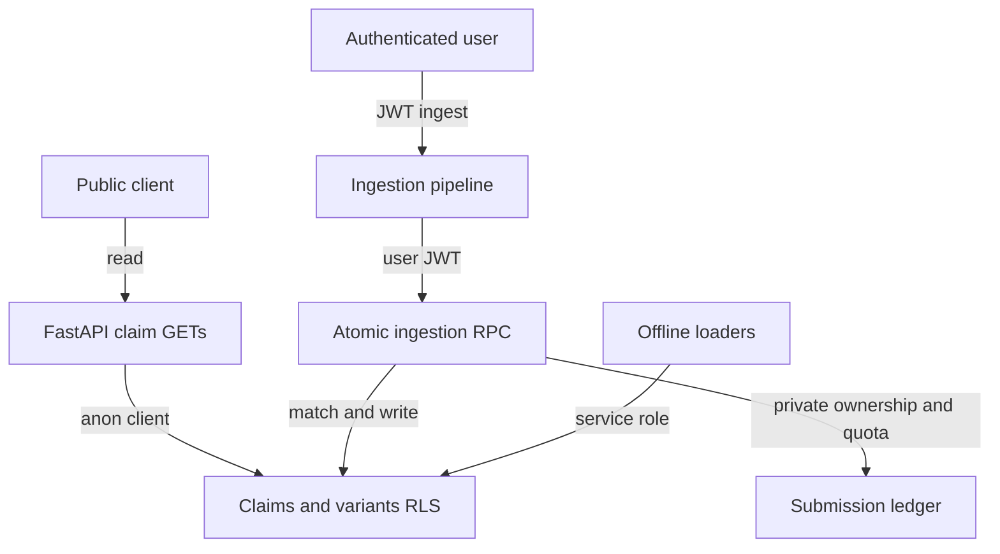

# Requirements

### Goals
Permanently remediate all four confirmed findings without breaking dataset loaders, public claim browsing, mutation trees, velocity, or platform analytics.

### Required behavior
- `POST /api/claims/ingest` requires a valid Supabase JWT and enforces a configurable per-user rate limit.
- A submission is embedded before persistence. It joins the best existing claim above a documented similarity threshold; otherwise it creates a new claim. Matching and insertion are atomic under concurrent requests.
- User-submitted content is always stored and returned as `UNVERIFIED` unless a later, evidence-backed workflow supplies inspected claim-specific evidence. Gemini may normalize/domain-classify language, but may not issue a factual verdict.
- Generic domain links are labeled as suggested research resources, never citations or support for a verdict.
- Claim lists, trees, velocity, and platform breakdown remain publicly readable, as requested.
- Direct Supabase access is read-only for the public corpus. Anonymous/authenticated clients cannot directly insert, update, delete, or invoke internal matching primitives.
- Submission ownership and rate-limit records remain private and do not expose user UUIDs in publicly readable corpus tables.

### Compatibility constraints
- Existing trusted dataset verdicts loaded by `app/data/loaders/*` remain intact because they originate from labeled datasets rather than unsupported submission inference.
- Privileged offline loaders continue using the service-role client and existing helper path.
- Existing claim analytics response shapes remain stable; ingestion can add explicit status/resource fields while retaining core summary fields.

# Technical Design

### Current implementation
- `app/services/pipeline.py` inserts a new claim before embedding, asks Gemini for a verdict, returns generic `source_router.py` links as sources, and reconstructs only the inserted row.
- `app/routes/claims.py` has no authentication or throttling and leaks raw exception text.
- `app/core/supabase.py` exposes only singleton service/anon clients for data operations.
- `schema.sql` defines `match_variants`, but has no RLS, policies, ownership ledger, grants, or atomic ingestion operation.
- There are no automated tests under `backend` despite existing `pytest`, `pytest-asyncio`, and `httpx` dependencies.

### Key decisions
- Preserve public read access, but require authentication for ingestion.
- Add a private `claim_submissions` ledger keyed by `user_id` and `variant_id`; do not add owner UUIDs to publicly readable `claims` or `variants`.
- Use a request-scoped Supabase client carrying the caller JWT to invoke one `security definer` ingestion RPC. The function checks `auth.uid()`, rate limits from the private ledger, takes an advisory transaction lock for the match key/user, finds the nearest eligible variant, creates a claim only when needed, inserts the variant and ledger row, and returns IDs/match metadata.
- Keep service-role access only for explicit loader/admin helpers. Public API reads use the anon client so RLS is exercised rather than bypassed.
- Treat model output as extraction/classification only. Submission verdict and rationale are server-controlled constants (`UNVERIFIED`, evidence-required explanation).

### Proposed changes
- `backend/schema.sql`
  - Add the private submission ledger, indexes, foreign keys, RLS enablement, and explicit policies.
  - Enable and force RLS where appropriate on `claims`, `variants`, and the ledger.
  - Grant public `SELECT` on corpus tables; revoke public DML and direct execution of `match_variants`.
  - Add an authenticated-only atomic ingestion RPC with a fixed server-side search path, qualified objects, validated dimensions/arguments, deterministic nearest-match selection, per-user quota enforcement, and minimal return contract.
  - Preserve service-role loader behavior and make migration statements repeatable for existing deployments.
- `backend/app/core/supabase.py`
  - Add a non-singleton user-scoped client factory accepting the bearer token.
  - Separate public read helpers from privileged loader helpers so API code cannot accidentally use the service role.
  - Wrap the atomic RPC and map database quota/auth errors to stable application errors.
- `backend/app/services/pipeline.py`
  - Remove verdict/rationale from `_EXTRACT_PROMPT`; validate/normalize Gemini output against allowed domain/language values.
  - Embed once, call atomic ingestion with the user-scoped client, and return the actual claim ID and count/match status.
  - Set submitted variants and summaries to `UNVERIFIED`; return generic links under an explicit `research_resources`/advisory contract.
  - Route list/tree/velocity/platform reads through public read helpers and remove obsolete one-row parent reconstruction from submission ingestion. The matched nearest earlier variant becomes the inserted row's parent atomically.
- `backend/app/routes/claims.py`, `backend/app/schemas/claims.py`, `backend/app/config/config.py`, and `backend/.env.example`
  - Require `Depends(get_current_user)` plus bearer credentials on ingestion and pass identity/token into the pipeline.
  - Add bounded request validation and stable `401`, `429`, and sanitized `500` responses.
  - Add configurable matching threshold/window/quota settings with secure defaults and explicit response models.
  - Keep GET routes public.
- `backend/app/services/source_router.py`
  - Rename/reframe output semantics as research destinations and ensure no copy implies pages were inspected.

### Security boundaries

### Risks and mitigations
- Similar but distinct claims could merge: use a configurable conservative threshold, select only the best match, return match similarity for observability, and test below/above-boundary cases.
- Concurrent first submissions could create duplicates: transaction-level advisory locking plus atomic SQL removes the current check/insert race.
- Enabling RLS could break loaders: retain service-role helpers and verify each loader path in integration tests.
- Public reads could leak ownership: ownership exists only in the private ledger, with no public policy or grant.
- Existing deployments may retain permissive grants: migration explicitly revokes and re-grants least privilege rather than relying only on RLS.

# Testing

### Validation approach
Add isolated Python tests plus a disposable Supabase/Postgres integration suite for behavior that mocks cannot prove. Tests should avoid real Gemini calls by injecting/mocking extraction and embeddings.

### Key scenarios
- First submission creates one claim/root variant; duplicate and paraphrase submissions attach to it and increase tree/velocity/platform counts.
- A below-threshold submission creates a separate claim; concurrent equivalent submissions do not create duplicate roots.
- Gemini output cannot cause a submitted claim to become `REAL` or `FAKE`; extraction failure remains `UNVERIFIED`.
- Generic links are returned only as advisory research resources, not evidence citations.
- Missing/invalid JWT ingestion returns `401`; quota exhaustion returns `429`; public GET endpoints remain accessible.
- Raw internal/database errors are logged server-side but not returned to clients.
- Anonymous and authenticated direct database clients can select the intended public columns but cannot mutate corpus rows, read the private ledger, or execute internal matching.
- Service-role dataset loaders still insert labeled claims/variants successfully after RLS is enabled.

### Test locations
- Add route and service tests under `backend/tests/` for auth, error mapping, extraction safety, matching responses, and analytics regressions.
- Add database integration tests or SQL assertions under `backend/tests/integration/` for RLS/grants, RPC atomicity, ownership privacy, quota enforcement, and concurrency.

# Delivery Steps

### ✓ Step 1: Harden verdict and API contracts
User submissions can no longer receive unsupported factual verdicts, and ingestion has an explicit safe contract.

- Update `app/services/pipeline.py` so Gemini only extracts canonical text, domain, and language.
- Force submission verdicts to `UNVERIFIED` with an evidence-required rationale.
- Reframe `source_router.py` links as advisory research resources.
- Add strict request/response models and bounded text validation in `app/schemas/claims.py`.
- Add unit tests proving hostile or malformed model output cannot create `REAL`/`FAKE` submissions.

### ✓ Step 2: Add durable database security and ownership
Supabase exposes a public read-only corpus while ownership and quota data remain private.

- Extend `schema.sql` with the private `claim_submissions` ledger, constraints, indexes, and idempotent migration statements.
- Enable RLS and install explicit read/write policies for `claims`, `variants`, and the ledger.
- Revoke unsafe table/function privileges and grant only public corpus reads plus authenticated ingestion RPC execution.
- Preserve service-role access for `app/data/loaders/*`.
- Add integration checks for anon/authenticated denial, ownership privacy, public reads, and loader compatibility.

### ✓ Step 3: Implement atomic matching and rate-limited ingestion
Authenticated submissions atomically join the correct claim tree or create one new root while enforcing per-user quotas.

- Add the hardened SQL ingestion RPC to perform identity validation, quota checks, similarity matching, claim/variant insertion, parent assignment, and ledger recording in one transaction.
- Add advisory locking and deterministic nearest-match behavior to prevent concurrent duplicate roots.
- Add user-scoped client/RPC helpers in `app/core/supabase.py`; keep service and public clients explicitly separated.
- Refactor `pipeline.ingest_claim()` to embed once, call the RPC, and report actual match and variant-count results.
- Test new roots, exact duplicates, paraphrases, threshold misses, quota exhaustion, and concurrent ingestion.

### ✓ Step 4: Enforce route authorization and regression safety
The ingestion endpoint is authenticated and sanitized while all requested public analytics continue working.

- Update `app/routes/claims.py` to require the current user and bearer token only for `POST /ingest`.
- Map auth, validation, quota, and internal failures to stable `401`/`422`/`429`/sanitized `500` responses.
- Add matching/rate-limit settings to `app/config/config.py` and `backend/.env.example`.
- Route public reads through the anon/RLS path and retain existing tree, velocity, platform, and claim-list shapes.
- Add route-level regression tests for public GET access, protected ingestion, non-leaking errors, and analytics after repeated submissions.